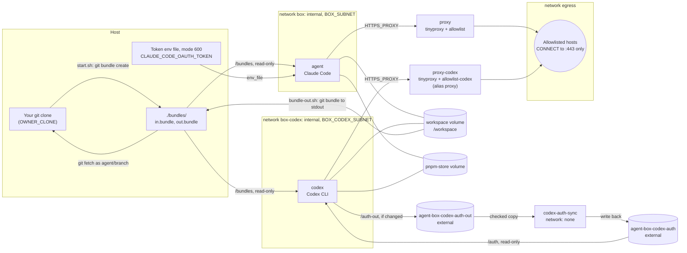
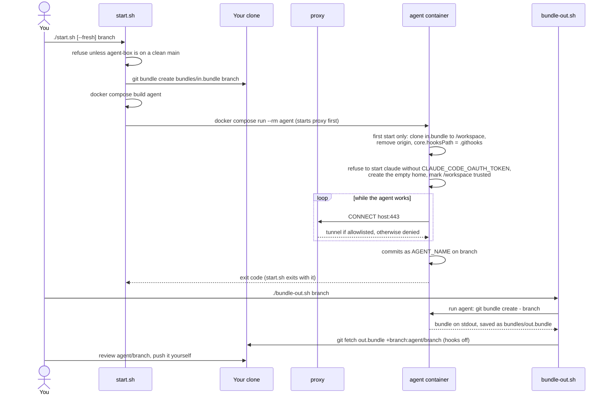
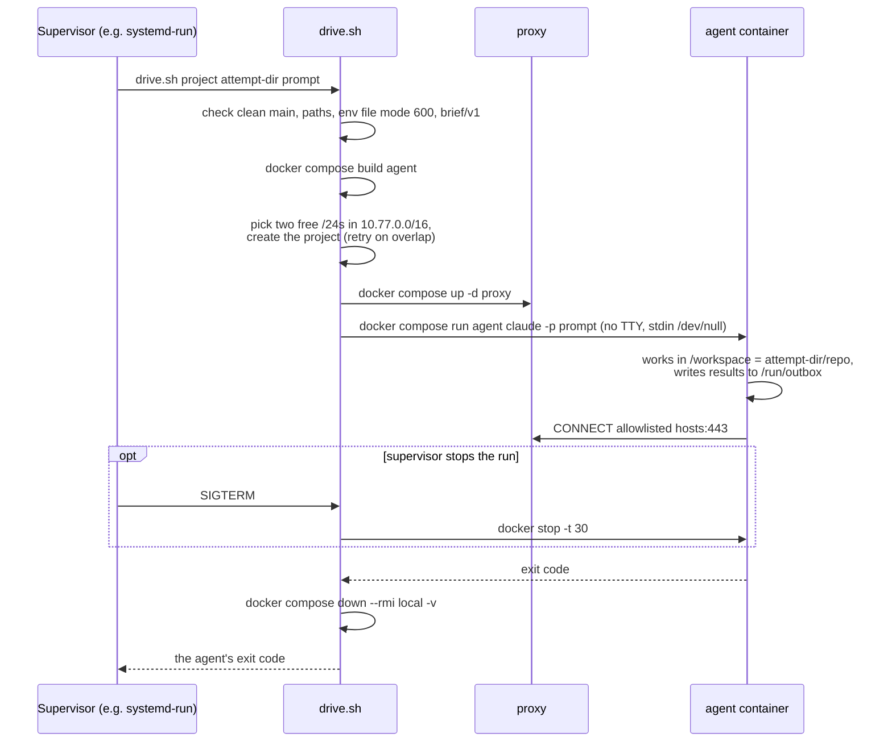

# agent-box

agent-box runs the official [Claude Code](https://code.claude.com) CLI,
and optionally OpenAI's Codex CLI, unattended inside a locked-down Docker
container. The container holds no GitHub token, SSH key or Docker socket.
Its only route to the internet is a proxy sidecar that lets it reach a
short list of allowed hosts. Code goes in as a git bundle and comes out as
a git bundle, and you review and push it from the host yourself.

Why: an agent with permission prompts turned off can run any command. Here
that freedom is fenced by the container and the network instead of by
prompts. A run can change what it was given (its workspace, and for an
unattended run its outbox) and talk to the allowlisted hosts, and
nothing else.

It is a small set of shell scripts and two compose files. It is not a
product. It was written for one person's workflow and is published as-is.

## Contents

- [Security model](#security-model)
- [Prerequisites](#prerequisites)
- [Quick start](#quick-start)
- [How a run works](#how-a-run-works)
- [Unattended runs: `drive.sh`](#unattended-runs-drivesh)
- [Codex](#codex)
- [Configuration](#configuration)
- [Files](#files)
- [Limits and non-goals](#limits-and-non-goals)
- [The owner's workflow](#the-owners-workflow)
- [License](#license)

## Security model

What the agent can reach, in plain terms:

- **Network.** The agent sits on an internal Docker network with no route
  out. The only thing it can talk to is its proxy (tinyproxy), which
  accepts connections only from that network's subnet, allows `CONNECT`
  tunnels only to port 443, and denies every host not in its allowlist.
  Claude's proxy allows `api.anthropic.com`, `console.anthropic.com`,
  `platform.claude.com`, `registry.npmjs.org` and `nodejs.org`
  ([`proxy/allowlist`](proxy/allowlist)). Codex has its own proxy on its
  own network with its own list ([`proxy/allowlist-codex`](proxy/allowlist-codex)).
- **Credentials.** Claude gets one thing: `CLAUDE_CODE_OAUTH_TOKEN` as an
  environment variable, read from an env file on the host. Codex gets only
  its own `auth.json`. Neither can see the other's. There is no git remote
  and no push credential, so nothing in the box can push.
- **Container.** User 1000, read-only root filesystem, every Linux
  capability dropped, `no-new-privileges`, 2048 processes and 8 GB of
  memory at most. `/tmp` (2 GB) and the home directory are tmpfs.
- **Nothing carries over between runs.** The agent's home
  (`CLAUDE_CONFIG_DIR`, `CODEX_HOME`) is on a tmpfs and starts empty each
  run, so nothing a run writes there (a global `CLAUDE.md` or `AGENTS.md`,
  a config, a skill) reaches a later run. Claude writes nothing back.
  Codex's `auth.json` is the one exception, and it goes back only through
  a checked copy (see [Codex](#codex)).
- **Agent settings are baked in.** Claude Code's managed settings
  ([`managed-settings.json`](managed-settings.json), at `/etc/claude-code/`
  on the read-only root) set permission mode `auto`, turn auto memory off,
  and deny tools that make no sense unattended (plan mode, cron and
  wake-ups, notifications, questions to the user, and a few more). Codex's
  managed config and requirements (in [`codex/`](codex), at `/etc/codex`)
  turn off hosted web search, apps and plugins (each would reach services
  through OpenAI's side, past the allowlist), memories and the background
  server.
- **The launchers check themselves.** `start.sh` and `drive.sh` refuse to
  run unless this checkout is on `main` with no uncommitted changes, since
  a changed file here is the one thing that would quietly widen what the
  agent can reach.
- **Getting work out is your step.** `bundle-out.sh` fetches the agent's
  branch into your clone as `agent/<branch>`, with git hooks and fsmonitor
  turned off for that fetch. It never pushes.

See [Limits and non-goals](#limits-and-non-goals) for what this does not
protect against.

## Prerequisites

- A Linux x86_64 host. The image downloads an x86_64 `sqld` binary.
- Docker Engine with Compose v2, recent enough for `env_file` entries with
  `required:` and the `!override` tag.
- git, and `jq` on the host for `drive.sh`.
- The `claude` CLI on the host, signed in to a Claude subscription, to mint
  the token.
- For Codex: a ChatGPT account. Codex is set to ChatGPT sign-in only.

## Quick start

1. **Mint a token** on the host. `claude setup-token` prints a long-lived
   token (valid for one year, for model requests only) and does not save
   it. See Anthropic's
   [authentication docs](https://code.claude.com/docs/en/authentication).

   ```sh
   claude setup-token
   ```

2. **Put it in an env file outside every repo**, readable only by you.
   This is the default path; `AGENT_BOX_CLAUDE_ENV` overrides it.

   ```sh
   install -d -m 700 ~/.config/rsb/agent-box
   install -m 600 /dev/null ~/.config/rsb/agent-box/claude.env
   $EDITOR ~/.config/rsb/agent-box/claude.env   # CLAUDE_CODE_OAUTH_TOKEN=...
   ```

   > [!WARNING]
   > The token is tied to the subscription of whoever ran
   > `claude setup-token`. Do not share it, commit it, or put it in any
   > other box. To rotate it, run `claude setup-token` again and replace
   > the file.

3. **Say who the agent commits as and where your code is.** Commits inside
   the box carry this identity through `GIT_AUTHOR_*` and
   `GIT_COMMITTER_*`.

   ```sh
   export AGENT_NAME='my-bot' AGENT_EMAIL='my-bot@example.com'
   export OWNER_CLONE=/path/to/your/clone
   ```

4. **Start the box on a branch** of that clone. This bundles the branch,
   builds the image, starts the proxy and opens Claude Code in the
   container.

   ```sh
   ./start.sh feature-x
   ```

5. **Bring the work out** when the agent is done. This fetches the box's
   branch into your clone as `agent/feature-x`. Review it there and push
   it yourself.

   ```sh
   ./bundle-out.sh feature-x
   ```

To see which hosts the box reached:

```sh
docker compose -p agent-box logs proxy proxy-codex | grep CONNECT
```

`./start.sh` takes a command after the branch, which replaces `claude`.
`./start.sh --fresh feature-x true` is a quick smoke test: it should exit 0,
and the proxy log should show only allowlisted hosts.

The desk workspace is a Docker volume that lasts between runs, so you can
stop and resume. If you start again on a new bundle, the entrypoint keeps
the existing workspace and warns if its HEAD differs from the bundle's.
`--fresh` deletes the workspace and clones the new bundle, so bundle out
any work first.

## How a run works

### The parts

The desk setup from `compose.yaml`, as `start.sh` and `bundle-out.sh` use
it. Every compose project gets its own copy of the networks, proxies and
workspace. Only the two Codex auth volumes are shared, by name.



### A desk run, step by step



The agent runs as a child of the entrypoint, not with `exec`, so stop
signals reach it and the entrypoint can still act after it exits. That is
how Codex's sign-in gets copied out.

## Unattended runs: `drive.sh`

`drive.sh` runs one attempt with no terminal and no person present: it
runs `claude -p '<prompt>' [option...]`, prints the agent's stdout on its
stdout and everything else on stderr, and exits with the agent's exit
code.

```sh
AGENT_NAME=... AGENT_EMAIL=... ./drive.sh <project> <attempt-dir> '<prompt>' [claude option...]
```

- `<project>` is the compose project for this attempt. It must be a valid
  compose project name and must not be `agent-box`, the desk's.
- `<attempt-dir>` must already hold `repo/` (a git checkout),
  `run/brief.json` and `run/outbox/`. Nothing is created; a missing path
  fails the launch.

It is meant to run under a supervisor, for example a transient
`systemd-run` unit. A stop signal (`TERM`, `INT` or `HUP`) becomes
`docker stop` with a 30-second grace period. Once the project is created,
any exit takes the whole project down, its images and volumes with it.

A launch under `systemd-run` could look like this (an example, not part
of this repository):

```sh
systemd-run --user --wait --pipe --collect \
  -E AGENT_NAME=my-bot -E AGENT_EMAIL=my-bot@example.com \
  "$PWD/drive.sh" attempt-1 /path/to/attempt-1 'Do the task in /run/brief.json'
```

Before it starts anything, it checks that this checkout is on a clean
`main`, that every path exists and is not a symlink, that the token env
file is a regular file of mode 600 (it never reads the contents), and
that `run/brief.json` has `"schema": "brief/v1"` and
`"outbox_path": "/run/outbox"`.

`compose.driver.yaml` is layered on top of `compose.yaml`. It takes away
the terminal and replaces the agent's mounts. These are the only host
paths the agent sees:

| Host | In the box |
| --- | --- |
| `<attempt-dir>/repo` | `/workspace` (read-write) |
| `<attempt-dir>/run/brief.json` | `/run/brief.json` (read-only) |
| `<attempt-dir>/run/outbox` | `/run/outbox` (read-write) |
| `$RSB_SKILLS/skills/engineering/{implement,tdd,rsb-code-review}` | `/skills/<name>` (read-only), linked into `~/.claude/skills` |

There is no bundle here: the attempt's checkout is mounted directly, and
whatever launched `drive.sh` reads the result from `repo/` and
`run/outbox/`. The three skill directories are required; see
[the owner's workflow](#the-owners-workflow).

Each project picks two free /24 subnets in `10.77.0.0/16` for its
networks, so attempts and the desk can run at the same time. If two
launches pick the same subnet, Docker refuses the second, which picks
again (up to five tries).



`drive.sh` runs Claude only; it has no Codex mode.

## Codex

`./start.sh --codex <branch>` runs the `codex` service instead of `agent`,
with `codex` as the default command. It uses the same container shape and
the same workspace, but its own network and proxy (`proxy-codex`, which
answers to the name `proxy` there, so the environment is the same). Inside
the box, Codex's own sandbox is off (`danger-full-access`, approvals
`never`): its bundled sandbox needs user namespaces, which the container
does not grant, and the container is the sandbox.

Codex still signs in through a file, not a token:

- Its `auth.json` lives on the external volume `agent-box-codex-auth`. Every
  compose project, the desk's and each attempt's, shares this one sign-in.
- At start the entrypoint copies `auth.json` from `/auth` (read-only) into
  the empty home. If the run changed it, the entrypoint copies it to
  `/auth-out` after the agent exits.
- `codex-auth-sync` runs with no network and only the two auth volumes
  mounted, before and after each `start.sh --codex` run. It writes
  `/auth-out/auth.json` back only if it is a regular file of at most 1 MiB that
  parses as a JSON object, then empties `/auth-out`. Before the run, it
  writes back anything an interrupted run left behind.
- `docker stop` still lets the copy happen. `SIGKILL` loses any refresh
  made during that run.

Create the volumes once, before the first run, then sign in from the desk
(`./start.sh --codex <branch>`, then `codex login`):

```sh
for v in codex-auth codex-auth-out; do docker volume create agent-box-$v; done
```

## Configuration

Environment variables the scripts read:

| Variable | Used by | Meaning |
| --- | --- | --- |
| `AGENT_NAME`, `AGENT_EMAIL` | `start.sh`, `bundle-out.sh`, `drive.sh` | Required. The identity for commits made in the box. |
| `OWNER_CLONE` | `start.sh`, `bundle-out.sh` | Required. The clone that branches are bundled from and fetched back into. |
| `AGENT_BOX_CLAUDE_ENV` | compose files, `drive.sh` | The env file holding `CLAUDE_CODE_OAUTH_TOKEN`. Default `~/.config/rsb/agent-box/claude.env`. |
| `RSB_SKILLS` | `drive.sh` | The checkout that holds the three skills `drive.sh` mounts. Its default is a path on the owner's machine, so set it. |
| `BOX_SUBNET`, `BOX_CODEX_SUBNET` | `compose.yaml` | Subnets of the two internal networks. Default `10.77.0.0/24` and `10.77.1.0/24`. `drive.sh` picks its own. |

The scripts set `BRANCH`, `ATTEMPT_DIR`, `COMPOSE_PROJECT_NAME` (`agent-box`
for the desk) and `COMPOSE_FILE` themselves.

Inside the box, the agent's traffic goes through `HTTP(S)_PROXY` to
`http://proxy:3128`, except `localhost` and `127.0.0.1`. Claude Code runs
with `CLAUDE_CODE_DISABLE_NONESSENTIAL_TRAFFIC=1`,
`CLAUDE_CODE_DISABLE_AUTO_MEMORY=1` and `DISABLE_AUTOUPDATER=1`.

To let the agent reach another host, add it to `proxy/allowlist` (or
`allowlist-codex`), commit, and run again. The launchers rebuild before
every run. Entries are `fnmatch` patterns.

## Files

- `Dockerfile`: the image. Node 24, pnpm, Claude Code, Codex, `sqld` and
  Playwright Chromium, each pinned by version (`sqld` also by checksum).
  It is shaped for one Node project; other projects need their own image.
- `compose.yaml`: the services `agent`, `codex`, `proxy`, `proxy-codex`
  and `codex-auth-sync`, the networks `box`, `box-codex` and `egress`, and
  the volumes. It sets no project name: the desk runs as `agent-box`, each
  `drive.sh` attempt as its own project.
- `compose.driver.yaml`: what an unattended launch puts on top.
- `proxy/`: the tinyproxy image, its config and the two allowlists. One
  image is built per proxy, each with its own allowlist and subnet.
- `entrypoint.sh`: clones the bundle on first start, prepares the per-run
  home, links skills from `/skills`, refuses to start `claude` without a
  token, runs the agent and copies Codex's sign-in out.
- `auth-sync.sh`: the Codex write-back described above.
- `managed-settings.json`, `codex/`: the agents' settings, baked into the
  image.
- `start.sh`, `bundle-out.sh`: the desk launcher and the way out.
- `drive.sh`: the unattended launcher.

## Limits and non-goals

- **The allowlist limits where, not what.** Anything the agent can read,
  including its own token and the workspace, it could send to an
  allowlisted host. The proxy filters by host name and does not inspect
  TLS. Its config limits `CONNECT` tunnels to port 443 but does not turn
  off plain-HTTP forwarding, so `http://` requests to an allowlisted host
  pass as well.
- **The token is the agent's.** It sits in the agent's environment, so
  any process in the box can read it. Use a token you would be willing to
  rotate after any run.
- **Container isolation, not a VM.** The box relies on Docker and the host
  kernel.
- **The repo's own hooks run in the box.** The clone sets
  `core.hooksPath` to the branch's `.githooks`.
- **The desk workspace is a Docker volume**, not your clone, and lasts
  until `--fresh`. An unattended run, by contrast, writes straight into
  `<attempt-dir>/repo`.
- **One image, x86_64 only**, set up for a Node project with pnpm.
- **No GitHub actions in the box.** It never pushes, opens pull requests
  or comments. That stays on the host, with you or with whatever drives
  the box.
- **`drive.sh` is coupled to the owner's setup**: it requires three
  particular skill directories and a `brief/v1` file.

Planned: per-repo images under `images/<repo>/`, and the unattended driver
as the only launcher.

## The owner's workflow

agent-box is the container half of the owner's setup for running coding
agents while away. A separate driver (not in this repository) prepares
each attempt directory and its `brief/v1` brief, runs `drive.sh` under
`systemd-run` with one compose project per attempt, reads the results
from the outbox, and does all GitHub work on the host. The skills it
mounts (`implement`, `tdd`, `rsb-code-review`) come from the owner's
skills repository via `RSB_SKILLS`. The desk (`start.sh`) is used for
interactive work and for signing Codex in.

Contributor and agent rules for this repository are in
[`AGENTS.md`](AGENTS.md).

## License

MIT. See [`LICENSE`](LICENSE).
